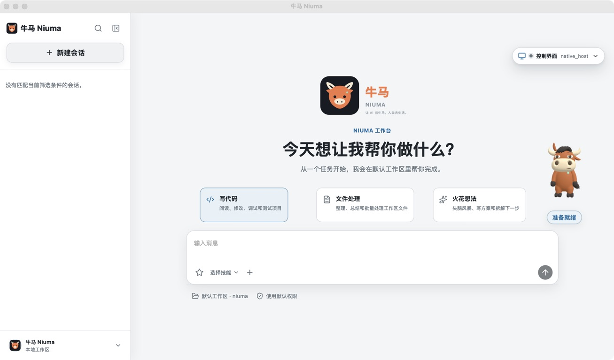

<p align="center">
  
</p>

<h1 align="center">牛马 <small>Niuma</small></h1>

<p align="center"><strong>让 AI 当牛马，人类去生活。</strong></p>

<p align="center">
  一个本地优先、开源、能持续推进长期任务的 AI Agent。<br>
  你交代目标，它在后台执行、验证进展；遇到阻塞就停下并清楚交接。
</p>

<p align="center">
  <a href="https://github.com/konglong87/niuma/releases/latest">下载桌面版</a> ·
  <a href="docs/getting-started.md">5 分钟上手</a> ·
  <a href="docs/use-cases.md">看使用场景</a> ·
  <a href="https://github.com/konglong87/niuma/discussions">加入讨论</a> ·
  <a href="README.en.md">English</a>
</p>

<p align="center">
  <a href="https://github.com/konglong87/niuma/actions/workflows/ci.yml"></a>
  <a href="LICENSE"></a>
  
</p>

<p align="center">
  
</p>

<p align="center"><em>真实 Niuma 桌面工作区：牛马 Logo 与 A 版「犟种丑萌」3D 宠物，非拼接效果图。</em></p>

### 你的桌面牛马

<p align="center">
  
</p>

在 **设置 → 宠物** 中启用。默认形象是 **牛马 Niuma · 犟种丑萌版**，此前的 **牛马经典版**、**Go 伙伴** 和 **中国龙** 均保留，可以随时切换。Go 伙伴和中国龙的已有选择不变；此前选择牛马的用户会看到 A 版，也可以改选牛马经典版。
支持待机、专注、庆祝动画，以及拖动、缩放和隐藏。上图小像为同一模型的透明渲染海报，不是桌面截图。详见[桌面个性化](docs/usage/desktop-personalization.md)。

## 牛马是什么？

**Niuma 是一个开源 AI 执行工作台，专为那些不必守着屏幕等它做完的任务而设计。**
它可以理解项目、规划步骤、调用工具、修改文件、运行命令和测试，并通过后台任务、
周期调度、会话恢复与检查点支持长任务推进。

它不是“保证永不停止”的黑盒。任务受你的设备、模型服务、预算与权限设置约束；遇到
需要授权、预算耗尽或无法继续的阻塞时，牛马会停下来说明情况，把决定权交还给你。

### 它能替你做什么？

- **离开后继续推进**：后台任务与周期调度适合需要多轮处理的工作。
- **中断后接着做**：会话恢复、Checkpoint 和 Rewind 帮你回看并继续任务。
- **把结果交代清楚**：运行日志、任务状态和测试结果便于检查，不只给一段“已完成”。
- **按你的边界行动**：权限审批、路径边界、预算与停止控制仍由你掌握。
- **用你熟悉的入口**：Desktop、CLI、TUI、WebUI、API、MCP 与飞书渠道共用运行时核心。

> “持续运行”描述的是后台任务和调度能力，不是无预算、无故障或保证成功。
> 实际运行时长取决于设备、网络、Provider、任务配置及权限。

## 先跑起来

### 桌面版

从 [GitHub Releases](https://github.com/konglong87/niuma/releases/latest) 下载对应平台版本，
在设置中选择模型服务并配置凭据，然后给牛马一个有明确验收条件的任务。

### CLI

```bash
git clone https://github.com/konglong87/niuma.git
cd niuma
go run ./cmd/niuma --version
go run ./cmd/niuma -p "检查当前项目结构，指出一个问题并运行对应验证"
```

需要 Go 1.26+。用户配置默认保存在 `~/.niuma/settings.json`。最小配置示例：

```json
{
  "provider": "custom",
  "providerProtocol": "openai-chat-completions",
  "baseURL": "https://model.example.com/v1",
  "apiKey": "replace-me",
  "model": "model-id"
}
```

完整步骤与排障说明见[5 分钟上手](docs/getting-started.md)。

## 不只是一个聊天窗口

| 场景 | 能力 | 你可以检查什么 |
| --- | --- | --- |
| 长期任务 | 后台 Goal、Checkpoint、会话恢复 | 当前状态、已完成步骤、阻塞原因 |
| 周期工作 | Loop 与本地调度器 | 下次触发时间、运行历史、日志 |
| Coding | 文件操作、命令执行、代码搜索、LSP、Git 工作流 | 变更和测试结果 |
| 工具扩展 | Skills、MCP、Workflow、Browser | 调用边界与任务输出 |
| 多 Agent | Profile、Teams、子 Agent 与任务编排 | 分工与汇总结果 |
| 接入方式 | Desktop、CLI、TUI、WebUI、API、飞书 Worker | 选择适合自己的入口 |
| 模型服务 | 自定义 Provider、兼容 API、多模态扩展 | 自行配置服务与凭据 |

先看[使用场景](docs/use-cases.md)，再看[产品架构](docs/architecture/agent_platform_architecture.md)。

## 本地优先，边界清楚

默认使用 SQLite，也支持面向团队部署的 MySQL。模型服务、MCP Server 和飞书等外部服务
需要你自己配置；请勿将 API Key 提交到仓库。运行 Agent 前，先了解
[安全与权限说明](SECURITY.md)和[配置指南](docs/getting-started.md)。

Niuma 的配置、任务状态、会话、记忆和调度数据使用独立的 `niuma` 身份与默认目录，
不会复用原 `go-e2e` 项目的应用数据目录。

## 品牌

**让 AI 当牛马，人类去生活。**

角色是一只原创的牛角马耳小牛马：大鼻子、柔和眼神、歪耳朵，一脸不服，事情照干。勤快但不逞强，做完展示证据，遇到边界就交接。

## 来源与许可

Niuma 是基于 [`go-e2e`](https://github.com/konglong87/go-e2e) 在
`fffd62dd06d7b3a09dbc6eebdbbccbb814cea827` 的源码快照建立的独立项目，采用 Apache-2.0。
来源记录与许可见 [`UPSTREAM.md`](UPSTREAM.md) 和 [`LICENSE`](LICENSE)。

## 了解更多

- [5 分钟上手](docs/getting-started.md)
- [使用场景](docs/use-cases.md)
- [配置参考](docs/configuration.md)
- [WebUI 指南](docs/usage/webui.md)
- [飞书渠道](docs/usage/feishu.md)
- [桌面个性化](docs/usage/desktop-personalization.md)
- [路线图](docs/roadmap.md)
- [更新日志](CHANGELOG.md)
- [贡献指南](CONTRIBUTING.md)
